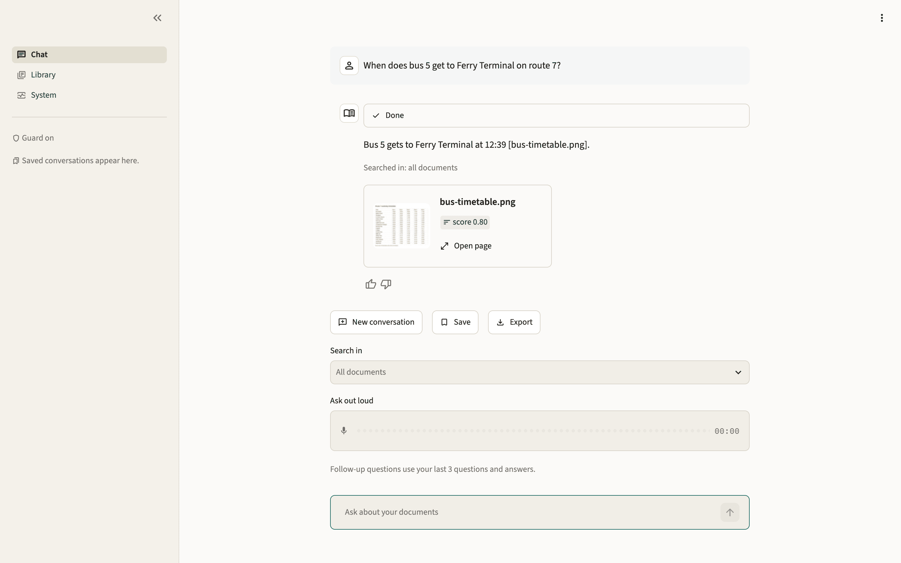
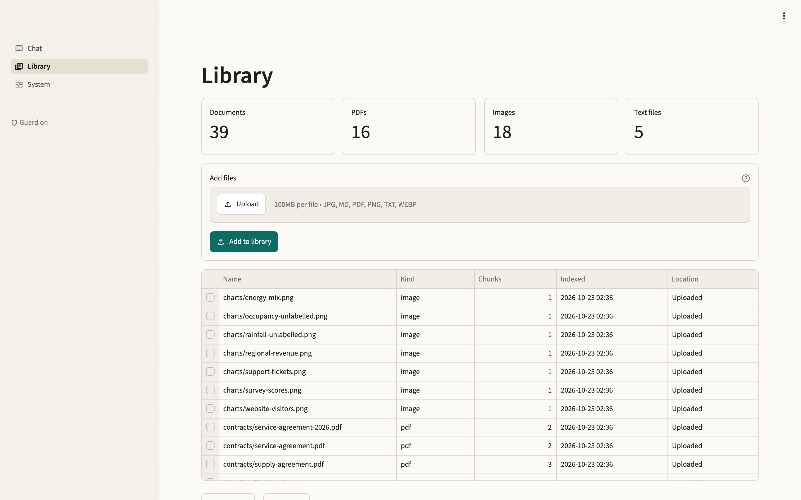
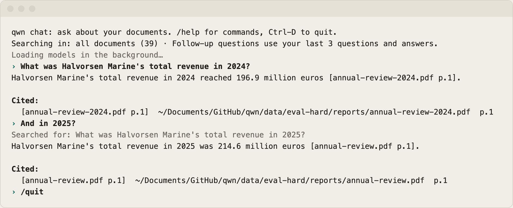
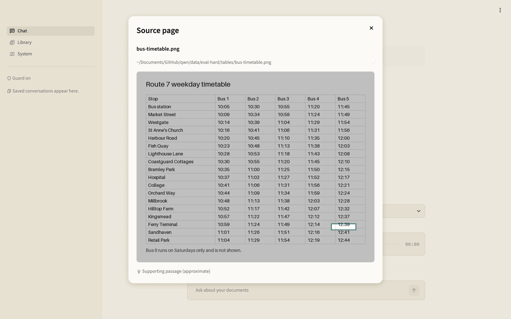

# qwn

Ask questions about your PDFs, images and notes, and get answers with page citations. qwn is a
private multimodal RAG app that runs entirely on your Mac with MLX: no cloud, no telemetry.

<picture>
  <source media="(prefers-color-scheme: dark)" srcset="docs/images/chat-dark.png">
  
</picture>

## Requirements

- Apple Silicon Mac with 32 GB of memory (built on an M2 Max)
- [uv](https://docs.astral.sh/uv/) and Python 3.12+
- About 13 GB of disk for the models (about 18 GB with voice)

## Setup

```bash
uv sync
uv run qwn models pull           # download the pinned models (~13 GB); the only network use
uv run qwn models pull --voice   # optional: speech in and out (~5 GB more)
uv run qwn models status         # check they're all present
```

After `models pull`, qwn runs fully offline (`HF_HUB_OFFLINE=1`). Run `qwn` from this folder, or
set `QWN_HOME` to it. To change settings, copy `qwn.example.toml` to `qwn.toml` and edit it.

## Use

```bash
uv run qwn ingest ~/Documents/papers           # index a folder in place (unchanged files are skipped)
uv run qwn ui                                  # the app on localhost: Chat, Library, System
uv run qwn ask "What was APAC revenue in Q3?"  # one answer with citations, e.g. [report.pdf p.4]
uv run qwn ask "..." --in ~/Documents/papers   # only search these files or folders
uv run qwn ask --audio q.wav --speak a.wav     # ask out loud, hear the answer
uv run qwn chat                                # a conversation: follow-ups like "and in 2025?"
uv run qwn search "APAC revenue"               # the best-matching pages, no answer
uv run qwn status                              # index, model cache and memory
uv run qwn eval review                         # turn 👍/👎 Chat ratings into private eval questions
```

<picture>
  <source media="(prefers-color-scheme: dark)" srcset="docs/images/library-dark.png">
  
</picture>

**Supported files:** PDF, PNG, JPEG, WebP, Markdown and plain text. Export slides to PDF first.

**One process at a time:** only one qwn process can hold the models. Close the UI before running
`ingest`, `search`, `ask`, `chat` or `eval` from the terminal.

### In the app and in `qwn chat`

| To | On the Chat page | In `qwn chat` |
|---|---|---|
| See an answer's sources | Source cards under it; **Open page** | `/sources` |
| Ask out loud | **Ask out loud** | (app only) |
| Save a conversation | **Save** | `/save` |
| Reopen one | Pick it in the sidebar | `/open N` or `qwn chat --open N` |
| Find one | Search box above the sidebar's list | `/list TEXT` |
| Rename one | **Rename** in the sidebar | `/rename N TITLE` |
| Export as Markdown | **Export** | `/export [PATH]` |
| Only search some files | **Search in** | `/in PATH` |

Type `/help` in `qwn chat` for every command.

<picture>
  <source media="(prefers-color-scheme: dark)" srcset="docs/images/terminal-dark.png">
  
</picture>

- **Citations:** **Open page** shows the cited page with the supporting passage outlined. The
  outline is approximate and takes a few seconds to find.
- **Voice:** your question is transcribed on your Mac, answered like a typed one, and the answer
  is read aloud. Silent recordings are rejected. Voice models load on first use and unload after
  10 idle minutes.
- **Saving:** nothing is kept unless you save. Saved conversations live in the index folder and
  reopen with their answers and pages; follow-ups carry on. Once a conversation is saved or
  reopened, each new answer is saved automatically.
- **Export:** a Markdown file with the questions, answers, citations and source paths, but no
  document text.

<picture>
  <source media="(prefers-color-scheme: dark)" srcset="docs/images/page-dark.png">
  
</picture>

## How it works

1. **Ingest:** PDF pages are rendered to images and their text is extracted. Notes are split into
   chunks by heading. Everything is embedded and stored in SQLite with sqlite-vec.
2. **Retrieve:** a vector search and a keyword search (FTS5) run together, their results are
   merged, and a reranker keeps the best five.
3. **Answer:** Qwen3-VL-8B reads the page images and text and answers, citing each source.
4. **Check:** Qwen3Guard screens the question and the answer.
5. **Highlight:** when you open a cited page, Qwen3-VL-8B finds the supporting passage and
   outlines it.
6. **Voice (optional):** Silero VAD trims silence and rejects empty recordings, Qwen3-ASR
   transcribes the question, and Qwen3-TTS reads the answer aloud.

## Models and licenses

qwn's code is Apache-2.0 (see `LICENSE`). Model weights aren't redistributed with qwn:
`qwn models pull` downloads them from Hugging Face under their own licenses, at the revisions
pinned in `src/qwn/models_lock.py`.

| Role | Model (MLX conversion by mlx-community) | Upstream | License |
|---|---|---|---|
| Answers | `mlx-community/Qwen3-VL-8B-Instruct-4bit` | Qwen3-VL-8B-Instruct (Qwen team, Alibaba Cloud) | Apache-2.0 |
| Embedding | `mlx-community/Qwen3-VL-Embedding-2B-8bit` | Qwen3-VL-Embedding-2B | Apache-2.0 |
| Reranking | `mlx-community/Qwen3-VL-Reranker-2B-8bit` | Qwen3-VL-Reranker-2B | Apache-2.0 |
| Safety | `mlx-community/Qwen3Guard-Gen-0.6B-MLX` | Qwen3Guard-Gen-0.6B | Apache-2.0 |
| Speech to text | `mlx-community/Qwen3-ASR-1.7B-8bit` | Qwen3-ASR-1.7B | Apache-2.0 |
| Text to speech | `mlx-community/Qwen3-TTS-12Hz-0.6B-CustomVoice-8bit` | Qwen3-TTS-0.6B | Apache-2.0 |
| Voice activity | `mlx-community/silero-vad` | Silero VAD (Silero Team) | MIT |

Thanks to the Qwen team for the models, the Silero team for Silero VAD, and the
[MLX](https://github.com/ml-explore/mlx) and mlx-community maintainers for the Apple Silicon ports.
